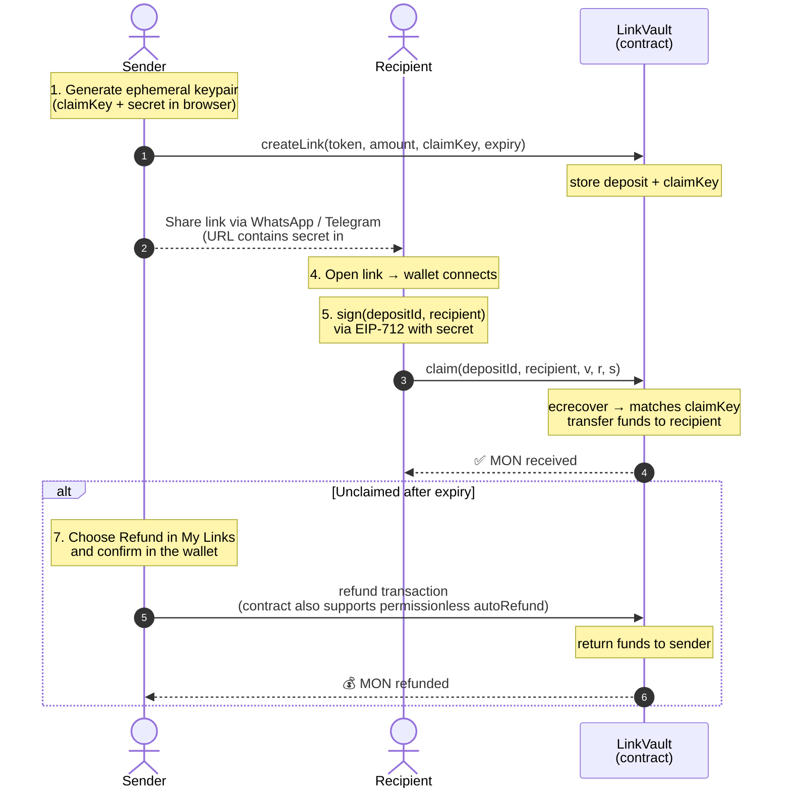

> **Metropolis extension:** Optional Lucky Links, AnomaPay Private Payment, contacts and passkey-encrypted history extend the original payment-link product. Both sites are live. LuckyVault has exact source verification, real testnet draws passed, and the private WMON mainnet pilot completed deposit, transfer, claim and recovery. See [submission fields](docs/metropolis-submission.json), [release evidence](docs/private-payment-release.json) and [contract receipts](contracts/deployments).

The reviewed visual system is recorded in [DESIGN.md](DESIGN.md), with reusable component previews in [.impeccable/design.json](.impeccable/design.json).

The updated mainnet and testnet sites, backup location, configuration, and verification results are recorded in [VPS deployment notes](docs/vps-deployment.md).

# MonliPay — Send tokens via a link

> Create a funded token link and share it in a chat. Recipients connect a wallet and claim. Recover eligible expired Payment and Lucky Link funds from My Links.

Originally built for the **BuildAnything "Spark"** hackathon on Monad. The **Metropolis** extension adds Lucky Links and private contacts; the [build-window disclosure](docs/lucky-links.md#what-is-new-for-metropolis) distinguishes this work from the existing foundation.

---

## Problem

Every time you want to send crypto to a friend, you have to:

1. Ask for their wallet address
2. Copy-paste it carefully
3. Check the first and last 4 digits
4. Hope you're on the right chain

Friends without a wallet? They can't receive anything at all.

## Solution

MonliPay turns token transfers into a shareable link:

1. **Create** — deposit MON (or any ERC-20) into the LinkVault contract
2. **Share** — send the link via WhatsApp, Telegram, or any messenger
3. **Claim** — recipient opens the link, connects their wallet, claims with one click
4. **Manage** — reopen saved links with a passkey in My Links or explicitly refund expired, unclaimed links with wallet confirmation

No address swapping. No chain confusion. One link is all you need.

---

## How It Works

### Secret-based claim (front-run resistant)

The core trick: the sender generates an **ephemeral keypair** in the browser using `crypto.getRandomValues`. The public address (`claimKey`) goes on-chain; the private key (the "secret") goes into the URL **fragment** (`#`).

```
https://monlipay.app/claim#42-5Kd3NBU5...
                          └─────────────┘
                          URL fragment — omitted from ordinary HTTP requests
```

When the recipient claims, their browser signs `(depositId, recipient)` via **EIP-712 typed data** with the secret key. The contract verifies the signature with `ecrecover` against `claimKey`.

The secret never appears in calldata. The visible claim signature binds the deposit and recipient, so copying it cannot redirect funds to another address.

[Saved links](docs/encrypted-link-backups.md) use browser encryption and a passkey, with no manual recovery-key setup for new users. The server stores ciphertext and public identifiers; WebAuthn PRF key material stays on the client. Existing recovery-key profiles can migrate once without changing their links. Passkey/provider support varies, and losing access to the passkey cannot be reset by MonliPay. The public [privacy page](https://monlipay.xyz/privacy) distinguishes protected claim secrets from public onchain activity. Optional [Private Payment](https://monlipay.xyz/create/private) uses AnomaPay on Monad mainnet, with passkey-encrypted account and link recovery. The [funded WMON pilot](docs/anoma-private-payment-readiness.json) passed. Transfers inside the pool are shielded from public chain observers; deposits, withdrawals, provider witness access and timing correlation remain privacy limits. This is a beta, not complete anonymity or an independently audited implementation.

### Flow diagram



**Why copying a claim cannot redirect funds:** its EIP-712 signature binds the recipient and deposit to the chain and verifying contract. The signature is visible in calldata; the ephemeral private key is not. URL fragments are excluded from ordinary HTTP requests, but deliberately sharing a complete URL still gives its holder the claim capability.

---

## Smart Contract — LinkVault.sol

A single contract with three core functions plus a permissionless auto-refund:

| Function | Description |
|---|---|
| `createLink(token, amount, claimKey, expiry)` | Deposit tokens (MON native or ERC-20), register claim key |
| `claim(depositId, recipient, v, r, s)` | Claim funds with a valid EIP-712 signature |
| `refund(depositId)` | Sender reclaims unclaimed funds after expiry |
| `autoRefund(depositId)` | **Permissionless** — anyone can trigger a refund to the original sender after expiry |
| `claimFailedRefund(depositId, recipient)` | Pull-pattern fallback if a push-transfer to sender fails (e.g. sender is a contract that rejects ETH) |

### Security features

- **`ReentrancyGuardTransient`** — uses Cancun `tstore`/`tload` opcodes (zero storage cost reentrancy protection)
- **`SafeERC20`** — handles non-standard tokens like USDT that don't return a bool
- **EIP-712 domain separation** — prevents cross-chain and cross-contract signature replay
- **EIP-2 s-value malleability check** — rejects high-order s-values and invalid v to prevent signature replay
- **Explicit `signer == address(0)` check** — defensive measure against `ecrecover`'s silent zero return
- **Expiry race fix** — at exact expiry, BOTH `claim()` and `refund()` revert (1-second no-mans-land prevents races)
- **Pull-pattern fallback** — failed ETH pushes (e.g. contract recipient that reverts on receive) park in `failedRefunds[]` instead of bricking the deposit
- **Fee-on-transfer support** — two-point balance reconciliation in both deposit and payout paths so the vault never tries to pay out more than it holds
- **Effects-before-interactions** — state updated before external transfers
- **Custom errors** — gas-efficient reverts (no string storage)

### Contract address

| Network | Chain ID | LinkVault | Forwarder (EIP-2771) |
|---|---|---|---|
| **Monad Testnet** | 10143 | [`0x90978783cb701AEe7896975B43ecd37e0B4819DC`](https://testnet.monadscan.com/address/0x90978783cb701AEe7896975B43ecd37e0B4819DC) | [`0xf7B6aE721d5C851A2269A675Ee43D60c3E34F9c9`](https://testnet.monadscan.com/address/0xf7B6aE721d5C851A2269A675Ee43D60c3E34F9c9) |
| **Monad Mainnet** | 143 | [`0xd7846DC6Fd8c159cF59957c532173d828f7B5BBC`](https://monadscan.com/address/0xd7846DC6Fd8c159cF59957c532173d828f7B5BBC) | [`0x90978783cb701AEe7896975B43ecd37e0B4819DC`](https://monadscan.com/address/0x90978783cb701AEe7896975B43ecd37e0B4819DC) |

All contracts are verified on Monadscan. The testnet deployment is the recommended starting point for judges and reviewers — try it at **https://testnet.monlipay.xyz** (testnet MON only — no real value at risk).

---

## Frontend

| Layer | Technology |
|---|---|
| Framework | Next.js 16 (App Router, Turbopack) |
| Web3 | wagmi v2 + viem v2 |
| Wallet UI | RainbowKit v2 (popup modal, MetaMask, WalletConnect, etc.) |
| Styling | Tailwind CSS v4 |
| Dark mode | next-themes (system / light / dark toggle) |
| 3D landing | three.js + @react-three/fiber + @react-three/drei |
| Bridge | LI.FI SDK (bridge tokens from other chains into MON) |
| Testing | Vitest + Testing Library (539 tests) |
| Coverage | 90.5% statements / 86.8% branches / 90.8% functions / 93.4% lines |
| Hosting | Vercel |

### Pages

- **`/`** — Payment-first landing and product demo
- **`/create`** — Create a payment link (select token, amount, expiry → get shareable URL)
- **`/claim`** — Claim a payment link (parse secret from URL hash → sign → claim)
- **`/my-links`** — Track Payment and Lucky Links, reopen passkey-protected links, explicitly refund expired payments
- **`/bridge`** — Bridge tokens from 9+ chains into Monad via LI.FI aggregator

### Features

- **RainbowKit wallet modal** — branded popup with MetaMask, WalletConnect, Coinbase, and more
- **Dark mode** — system-aware with manual toggle (sun/moon icon)
- **Prismatic envelope** — original artwork in the Monad-inspired ink/lilac visual system
- **Wrong-chain guard** — detects when wallet is on the wrong network and prompts switch
- **WhatsApp / Telegram share** — one-click share with pre-filled message
- **Indexed history** — visible tabs periodically refresh public payment status
- **Private saved links** — browser encryption, passkey access, device retry queue, manual and idle locking
- **Explicit refunds** — My Links asks for a deliberate refund action and wallet confirmation
- **Per-link failure surfacing** — if auto-refund skips a link (e.g. race), the UI flags it individually
- **Bridge integration** — bring tokens from Ethereum, Base, Arbitrum, Optimism, Polygon, BNB, Avalanche → Monad
- **Real token/chain logos** — pulled from trustwallet/assets, with official Monad brand-kit SVG
- **URL scheme validation** — shareable URLs are sanitized to reject `javascript:`/`data:`/credential injection

---

## Project Structure

```
paymentlink/
├── contracts/                       # Foundry project
│   ├── src/
│   │   └── LinkVault.sol            # Core contract: create / claim / refund / autoRefund
│   ├── test/
│   │   ├── LinkVault.t.sol          # Core flows + expiry boundary + fuzz
│   │   ├── LinkVaultAuditFixes.t.sol # Audit round 2 fixes (race, pull, fee-token, signer-0)
│   │   ├── LinkVaultCoverage.t.sol  # Revert paths for coverage
│   │   ├── LinkVaultSecurity.t.sol  # Malleability, reentrancy, non-standard tokens
│   │   └── mocks/
│   │       ├── MaliciousERC20.sol       # Reentrancy-attacking token
│   │       ├── MockFeeOnTransferERC20.sol # Configurable fee in bps
│   │       ├── MockNonStandardERC20.sol # USDT-style (no bool return)
│   │       └── ETHRefuser.sol           # Reverts on receive (for pull-pattern test)
│   ├── script/
│   │   └── DeployLinkVault.s.sol
│   └── foundry.toml
├── web/                             # Next.js 16 frontend
│   └── src/
│       ├── app/                     # Pages: /, /claim, /my-links, /bridge, /api/bridge/*
│       ├── components/              # ConnectButton, CreateForm, ClaimForm, LinkCard, Scene3D, ...
│       ├── config/                  # Chain config + wagmi config + token list
│       ├── hooks/                   # useCreateLink, useClaimLink, useAutoRefundExpiredLinks, useBridge, ...
│       └── lib/                     # ABI, crypto (EIP-712), storage, bridge-client, rate-limit
└── README.md
```

---

## Quick Start

### Prerequisites

- [Foundry](https://www.getfoundry.sh/) (smart contract development)
- Node.js 20+ (frontend)
- MetaMask or any EVM wallet

### 1. Deploy the contract

```bash
cd contracts
forge install

# Deploy to Monad Testnet
forge script script/DeployLinkVault.s.sol \
  --rpc-url https://testnet-rpc.monad.xyz \
  --private-key $YOUR_PRIVATE_KEY \
  --broadcast

# Note the deployed address from the output, then verify on Monadscan:
# https://testnet.monadscan.com/address/<your-address>

# (Optional) Verify source on Sourcify
forge verify-contract <your-address> LinkVault \
  --chain-id 10143 \
  --verifier sourcify \
  --verifier-url https://sourcify.dev/server/
```

### 2. Set up the frontend

```bash
cd web
npm install

# Configure environment
cp .env.testnet .env.local
# Edit .env.local:
#   - Set NEXT_PUBLIC_LINK_VAULT_ADDRESS to your deployed address
#   - Set NEXT_PUBLIC_WC_PROJECT_ID (free at cloud.walletconnect.com)
#   - (Optional) Set LIFI_API_KEY and ALCHEMY_API_KEY for the bridge feature

npm run dev
```

Open http://localhost:3000

### 3. Run tests

```bash
# Smart contract tests (92 tests, 100% line coverage on LinkVault.sol)
cd contracts
forge test -vv

# Frontend tests (539 tests, 90%+ coverage)
cd ../web
npm test

# Frontend coverage report
npm run test:coverage
```

---

## Testing

### Smart Contracts — 92 tests

| Suite | Tests | Coverage |
|---|---|---|
| `LinkVault.t.sol` | 46 | Core flows: create, claim, refund, double-claim, expiry boundary, fuzz |
| `LinkVaultAuditFixes.t.sol` | 20 | Audit round 2 fixes: race window, pull-pattern, fee-on-transfer, signer-0, sweep |
| `LinkVaultCoverage.t.sol` | 15 | All revert paths and error conditions |
| `LinkVaultSecurity.t.sol` | 11 | Signature malleability, reentrancy (native + ERC-20), non-standard tokens |

**Line coverage: 100% on `LinkVault.sol`.**

### Frontend — 539 tests

| Area | Coverage |
|---|---|
| Statements | 90.5% |
| Branches | 86.8% |
| Functions | 90.8% |
| Lines | 93.4% |

Covers all components, hooks, config, and utility libraries. Includes:
- Create / Claim / Refund / Auto-refund flows (with mutex, AbortController, per-link failures)
- Crypto utilities (keypair generation, EIP-712 signing, URL sanitization)
- Storage (localStorage link persistence, cross-tab sync)
- Bridge client (LI.FI quote parsing, route validation)
- Rate limiting & security headers

---

## Security Audit

Two rounds of pre-mainnet audit were performed. All findings resolved.

### Round 1 — 7 must-fix items (commit `2cb29e6`)
Reentrancy guards, signature malleability, expiry validation, etc.

### Round 2 — 5 HIGH + 6 MEDIUM/LOW findings (commit `1c5d4ad`)
- **HIGH-1**: Closed expiry race window (1-second no-mans-land)
- **HIGH-2**: Pull-pattern fallback for failed native ETH pushes
- **HIGH-3**: Ref-based mutex in `useAutoRefundExpiredLinks` (nonce-race prevention)
- **HIGH-4**: Cross-tab localStorage sync
- **HIGH-5**: Per-link error surfacing for auto-refund
- **MEDIUM-1**: Fee-on-transfer token support (two-point reconciliation)
- **MEDIUM-2**: Explicit `signer == address(0)` check
- **MEDIUM-5**: State cleanup on wallet disconnect
- **MEDIUM-7**: `sanitizeBaseUrl()` prevents `javascript:`/`data:`/credential injection
- **MEDIUM-10**: AbortController for stale auto-refund batches
- **LOW-5**: Toast auto-dismiss

---

## Tech Stack

- **Blockchain:** Monad — Ethereum-compatible L1, 10,000 TPS, 400ms blocks
- **Smart Contracts:** Solidity 0.8.28 + Foundry
- **Frontend:** Next.js 16 + wagmi v2 + viem v2 + RainbowKit v2
- **3D:** three.js + @react-three/fiber
- **Bridge:** LI.FI SDK
- **Styling:** Tailwind CSS v4 + next-themes (dark mode)
- **Testing:** Foundry (contracts) + Vitest (frontend)
- **Coverage:** 100% contract lines / 90%+ frontend statements

## License

MIT
